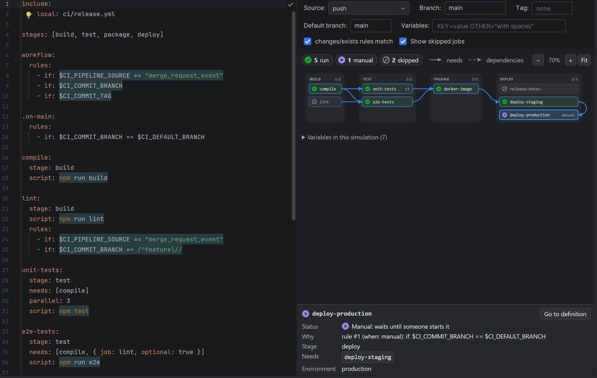

# GitLab CI Visualizer – GitLab pipeline visualization for JetBrains IDEs

**Visualize your GitLab CI/CD pipeline right in the IDE.** GitLab CI Visualizer is a plugin for JetBrains IDEs
such as WebStorm, IntelliJ IDEA, PyCharm, PhpStorm and GoLand. It shows a `.gitlab-ci.yml` as a pipeline graph
next to the editor, with stages, jobs and their `needs` dependencies, and it simulates which jobs run for a
branch, a tag or a merge request before you push.

It works like the *Visualize* tab of GitLab's pipeline editor, but locally, while you type, without a connection
to GitLab, and with a simulation of your `rules`.

## Features

- **Pipeline graph for `.gitlab-ci.yml`**: one lane per stage, one card per job, updated while you type. Each job
  shows its state with an icon and a color: runs, manual, delayed, skipped, or has a problem.
- **Job dependency graph**: `needs` are solid arrows, `dependencies` dashed ones. Select or hover a job to
  highlight everything it waits for and everything waiting for it.
- **Pipeline simulation**: choose the pipeline source, branch, tag, default branch and extra CI/CD variables. The
  graph shows which jobs that pipeline would contain. `workflow:rules` that prevent the pipeline and `needs` that
  cannot be met are reported.
- **Why a job runs or is skipped**: select a job to see the rule that decided it, what it needs, what needs it,
  and where it is defined. *Go to definition* jumps to the job in the editor, also into local includes.
- **Understands your configuration**: `extends`, `!reference`, local `include`, `rules`, `only`/`except`,
  `workflow`, `parallel` and `trigger` are resolved before drawing.
- **Keyboard and screen readers**: arrow keys move between jobs, `Enter` opens the definition, `Esc` clears the
  selection. States are never shown by color alone, and the colors are tested for contrast in both themes.

## Questions it answers

**How can I visualize a `.gitlab-ci.yml` file?**
Open it in the IDE. The editor splits, and the pipeline appears as a graph next to the YAML.

**Which jobs run for my branch, tag or merge request?**
Set the source, branch or tag in the toolbar above the graph. Jobs that would not be in that pipeline are shown
as skipped.

**Why is my GitLab CI job not running?**
Select the job. The details name the `rules`, `only`/`except` or `workflow` rule that excluded it.

**Which jobs does a job depend on?**
Select it. The chain of `needs` before and after it is highlighted, and the details list *Needs* and *Needed by*.

**Does it need access to my GitLab server?**
No. It reads the files in your project, nothing else.

## Deutsch: GitLab-Pipeline-Visualisierung in der IDE

GitLab CI Visualizer ist ein Plugin für JetBrains-IDEs (WebStorm, IntelliJ IDEA, PyCharm, PhpStorm, GoLand), das
eine GitLab-CI/CD-Pipeline direkt neben der `.gitlab-ci.yml` als Graph darstellt: Stages, Jobs und ihre
Abhängigkeiten (`needs`). Die Pipeline lässt sich für einen Branch, einen Tag oder einen Merge Request simulieren,
sodass man vor dem Push sieht, welche Jobs laufen und welche Regel einen Job überspringt. Die Installation ist
unten beschrieben; die Oberfläche des Plugins ist englisch.

## Installation

The plugin is not on the JetBrains Marketplace. You download one zip file and install it from disk. After that
the IDE finds new versions by itself.

### Requirements

- A JetBrains IDE **2026.2 or newer**. The plugin is built and tested with WebStorm 2026.2.1. It uses only the
  common IntelliJ Platform, so it should run in the other JetBrains IDEs of that version as well.
- The bundled plugin **Web Browser (JCEF)** must be enabled, which it is by default.

### 1. Download the plugin file

Download `gitlab-ci-visualizer-<version>.zip` from the
[latest release](https://github.com/svenbluege/gitlab-ci-visualizer/releases/latest). Do not unpack it.

### 2. Install it in the IDE

1. Open **Settings** (`Ctrl+Alt+S`) and go to **Plugins**.
2. Click the gear icon ⚙ and choose **Install Plugin from Disk…**
3. Select the zip file and confirm. Restart the IDE if it asks.

### 3. Use it

Open a file named `.gitlab-ci.yml` (or ending in `.gitlab-ci.yml` / `.gitlab-ci.yaml`). The editor splits: text
on the left, pipeline on the right. The three icons at the top right of the editor switch between text only,
both, and pipeline only.

| Field | Variable it sets | Meaning |
|---|---|---|
| Source | `CI_PIPELINE_SOURCE` | What starts the pipeline: push, merge request, schedule, … |
| Branch | `CI_COMMIT_BRANCH` | The branch. For a merge request: its source branch |
| Tag | `CI_COMMIT_TAG` | A tag turns it into a tag pipeline, which has no branch |
| Default branch | `CI_DEFAULT_BRANCH` | Also the target branch of a merge request |
| Variables | any | Extra variables, e.g. `DEPLOY_ENV=prod NOTE="two words"`. They override the file |
| changes/exists rules match | – | `changes` and `exists` cannot be checked; this decides whether such rules match |
| Show skipped jobs | – | Also show jobs that are not part of the simulated pipeline |

The simulation is remembered per project.

### Updates

Every push to the `main` branch publishes a new release. The plugin tells the IDE where the releases are, so the
IDE's regular plugin update check offers the new version like any other plugin update. To check right away, use
**Help → Check for Updates…** (on macOS it is in the application menu).

If automatic checks are switched off under **Settings → Appearance & Behavior → System Settings → Updates**, or
the IDE cannot reach github.com, download the newer zip and install it the same way; it replaces the old version.

### Uninstall

Open **Settings → Plugins → Installed**, select *GitLab CI Visualizer* and choose **Uninstall**.

### If something does not work

- **The file opens as plain YAML**: the file name must end in `.gitlab-ci.yml` or `.gitlab-ci.yaml`. Included
  fragments such as `ci/build.yml` stay plain YAML.
- **The plugin cannot be enabled or the right side stays empty**: enable the bundled plugin *Web Browser (JCEF)*
  under **Settings → Plugins → Installed** and restart.
- **“Plugin is incompatible”**: the IDE is older than 2026.2.

## Supported GitLab CI keywords

`stages`, `extends`, `!reference`, `include: local`, `rules` (`if`, `when`, `needs`), `only`/`except` (refs and
variables), `workflow:rules`, `needs`, `dependencies`, `when`, `parallel`, `trigger`.

Not evaluated:

- `include` of `project`, `remote`, `template`, `component` and wildcards: listed as a note, their jobs are missing.
- `changes` and `exists`: one checkbox decides whether such rules count as matching.
- Variables inside variable values are not expanded; `spec:inputs` are not interpolated.

## Development

The build needs JDK 25. The IDE brings one along in `<IDE install directory>/jbr`.

    ./gradlew test          # unit tests, plus tests that start a headless IDE
    ./gradlew buildPlugin   # build/distributions/gitlab-ci-visualizer-<version>.zip
    ./gradlew runIde        # a sandbox IDE with the plugin

The build downloads WebStorm (about 1 GB) unless you point it at an installed IDE. On Windows (PowerShell), using
the installed WebStorm as JDK and as the IDE to build against:

    $env:JAVA_HOME = "$env:LOCALAPPDATA\Programs\WebStorm\jbr"
    .\gradlew.bat buildPlugin "-PlocalIdePath=$env:LOCALAPPDATA\Programs\WebStorm"

Behind a proxy, put `systemProp.https.proxyHost` and `systemProp.https.proxyPort` into
`~/.gradle/gradle.properties`.

Releases are built by `.github/workflows/release.yml`. The version is `major.minor` from `gradle.properties` plus
the number of the workflow run, so every release is newer than the one before. The workflow also publishes
`updatePlugins.xml`, the file the installed plugins point the IDE to.

To render a file without an IDE, as `build/pipeline.html`:

    GITLAB_CI_FILE=path/to/.gitlab-ci.yml ./gradlew test --rerun

`GITLAB_CI_OUT`, `GITLAB_CI_BRANCH` and `GITLAB_CI_THEME=light` change the output file, the simulated branch
and the theme.

## License

[MIT](LICENSE). The plugin file also contains [SnakeYAML](https://bitbucket.org/snakeyaml/snakeyaml), which is
licensed under the Apache License 2.0.
